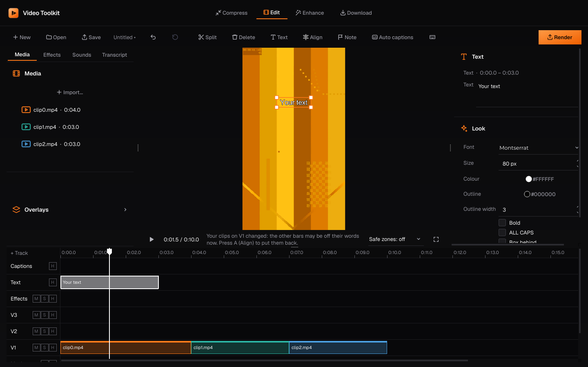
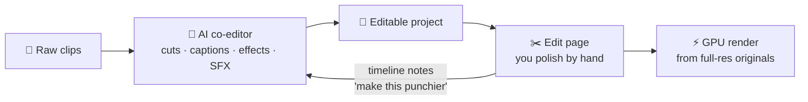
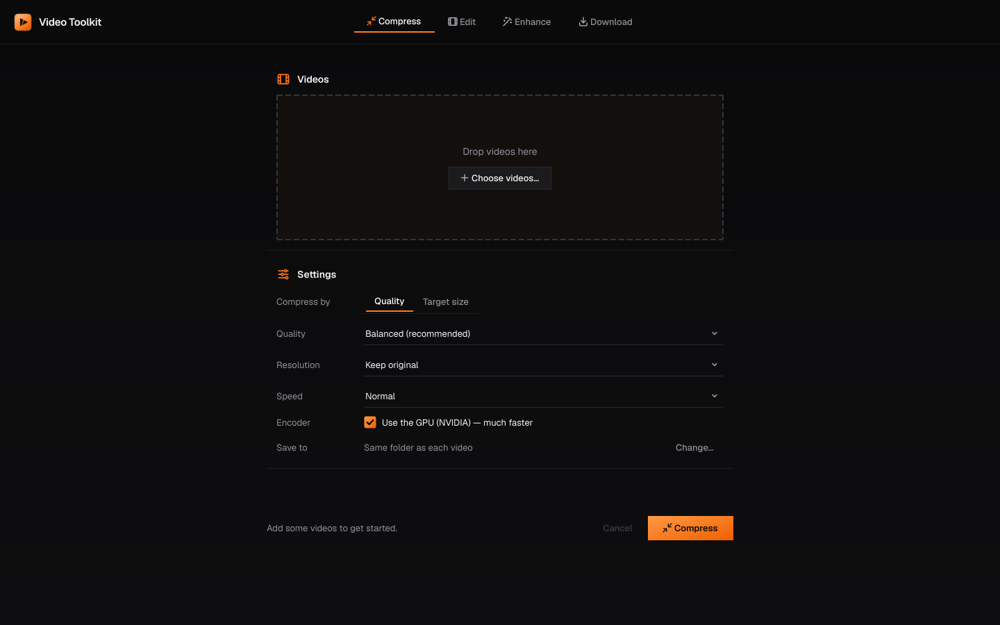

# Video Toolkit

**A GPU-accelerated desktop video editor for short-form content (Reels, TikTok, Shorts) on Windows, with an AI co-editor built in.** Drop in your raw clips and let the AI rough-cut them, with captions, effects and sound effects. You then polish everything by hand on a real timeline. Everything runs locally on your own GPU, and nothing is uploaded.

> 🔒 **This is a showcase.** Video Toolkit is a commercial project in development, and its source code is private.
> Interested? ⭐ Star or 👁️ watch this repo to hear when it launches, or [open an issue](../../issues) to get in touch.

## At a glance

| Tab | What it's for |
|---|---|
| ✂️ **Edit** | Timeline editor: cut, caption, add text, effects and sounds, then render |
| 📦 **Compress** | Shrink videos fast on the GPU, by quality or to a target size |
| ✨ **Enhance** | One-click cleanup: cut silences, denoise, level loudness, stabilise, colour, upscale |
| ⬇️ **Download** | Save a video from an Instagram / TikTok / YouTube link |

## How the AI workflow works

The AI never hands you a flat, finished video. It hands you a **project**, so every cut, caption and effect it made stays editable. Leave a note on the timeline and the AI picks it up on its next pass.

## Features

**Editing**
- Multi-track timeline (video, text, captions, effects, sounds) with split, trim, copy/paste and undo/redo
- **Auto captions** with word-level timing (Whisper on the GPU), caption styles and `.srt` export
- **Edit by transcript**: delete words to cut the video. *Align to voice* snaps text to the speech
- Effects (zoom punch, whip pan, flash, glitch, glow…), keyframes, masks, transitions and safe-zone guides
- Sound-effects library (whoosh, impact, riser, glitch) with drag-and-drop
- AI cut-out and hand-tracked "finger frame" effects
- Live preview from lightweight proxies. Your originals are never modified

**Compress.** NVIDIA NVENC encoding, by quality or to a target file size, in batches.

**Enhance.** Silence removal (jump cuts), audio denoise, loudness normalisation to −14 LUFS (what Instagram, TikTok and YouTube aim for), stabilisation, colour looks / LUTs and AI upscaling (Real-ESRGAN).

**Private by design.** No account, no cloud and no uploads. AI models download once and run on your machine.

## Built with

Python · Qt (PySide6) · ffmpeg (NVENC) · Whisper · ONNX Runtime GPU · MediaPipe · Real-ESRGAN · Model Context Protocol (MCP)

## Status

In active development on Windows 11 with NVIDIA GPUs.

---

© 2025-2026 João Gameiro. All rights reserved. The screenshots and text in this repository may not be reused without permission.
